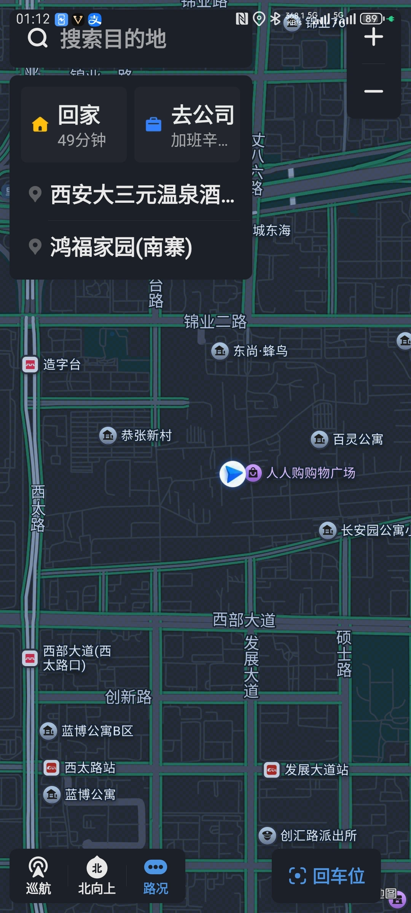
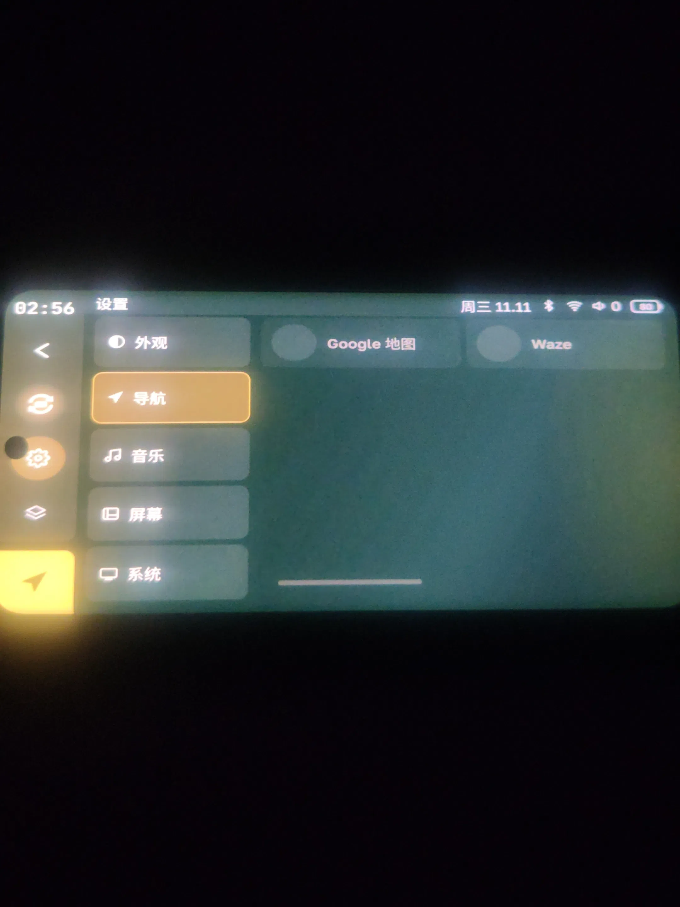
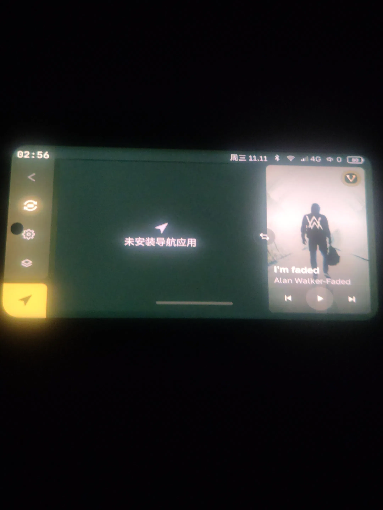

# Headswap 接入高德车机界面（UcarMapActivity）

给 [headswap](https://github.com/YegorkaPomidorka/headswap) 加一条绑定：让桌面上的「高德地图」入口、以及「设置 → 导航」里选中的高德，都直接拉起高德 APK 内置的**车机界面** `com.autonavi.map.activity.UcarMapActivity`，而不是手机版首页。

基于 headswap **4.1.1**（versionCode 73，targetSdk 37 / minSdk 29）。改动共 **7 个文件**，其中 1 个新增。

---

## 一、效果

| 场景 | 行为 |
|---|---|
| 全部应用里点「高德地图」 | 进车机界面（完整首页 UI：搜索目的地、回家 / 去公司、巡航、导航入口） |
| 桌面导航卡片 / 导航键 | 同上，同一个车机界面 |
| 设置 → 导航 | 多出「高德地图」一项，可选中作为默认导航 |



### 这个入口的性质

先明确一点：**这是高德地图 APP 内部的一个车联组件，不是另一个 App**。它与你在手机上打开的高德是同一个 APK、同一个进程、同一份安装包，只是包内另一个界面（`UcarMapActivity`，高德自己的「UCAR / 车联」模块）。装一个高德，手机首页和车机界面都在里面。

它不是"高德的接口"，而是这个模块对外开放的一个 Activity；我们是顺着 `exported` 这个口子，用显式 Intent 把它的车机界面拉进 headswap 的虚拟屏。

- 它**不在**高德开放平台的授权范围内：没有 SDK、没有 API key、没有文档、没有版本契约，也不是高德提供给我们用的通道。
- 它能被拉起，只因为清单里 `exported=true`，且门禁只判断一个 `isUcarMode` 布尔值（无签名、无包名白名单、无调用方校验）。
- 它**不是**独立安装的"高德车机版"：没有单独的 APK，也没有单独的图标，无法从系统桌面直接打开。
- 因此它是**绑在高德当前版本上的既成事实**：高德一旦把这个入口关掉或加上鉴权，本绑定即失效，headswap 其他功能不受影响，高德退回手机版界面。

---

## 二、为什么要这么绕

高德 17.x 的 APK 内置了三套车联界面（UCAR / HiCar / carlink），其中 UCAR 那套是给**车机端**用的：

- 组件：`com.autonavi.minimap/com.autonavi.map.activity.UcarMapActivity`
- 清单属性：`exported=true`、`taskAffinity=com.autonavi.ucar.map`、`launchMode=singleTask`、`excludeFromRecents=true`、`resizeableActivity=true`，**没有 `android:screenOrientation`**，**没有 `android:process`**
- 关键点：它**没有 `LAUNCHER` intent-filter**，所以桌面上看不到、也必须用显式组件启动

它认的参数只有三个（反编译 `UcarMapActivity.u(Intent)` 得到）：

| extra | 类型 | 含义 |
|---|---|---|
| `isUcarMode` | boolean | 唯一门禁。`LauncherUtil.e()` 只判这一个布尔，无包名/签名校验 |
| `screenMode` | int | `1` = 完整首页 UI；`2` = 只留地图、导航信息改走卡片 |
| `isActivityMetricsFirst` | boolean | 先取窗口 metrics 还是先建 surface |

本改动固定传 `isUcarMode=true`、`isActivityMetricsFirst=true`，`screenMode` 按当前窗口大小选：全屏导航区传 `1`，主页小卡片传 `2`（见第三节第 7 项）。

---

## 三、改了什么

### 1. 新增 `dex/UcarBind.kt`

常量 + 判定 + Intent 参数打包。判定有两层：

- `isAmap(component)`：**只要包名是 `com.autonavi.minimap`** 就算，不区分具体 Activity；
- `isCarShell(component)`：包名 + 类名都匹配 `UcarMapActivity`。

```kotlin
internal object UcarBind {
    const val PKG = "com.autonavi.minimap"
    const val CAR_ACT = "com.autonavi.map.activity.UcarMapActivity"
    const val MODE_FULL = 1
    const val MODE_CARD = 2

    fun isAmap(component: ComponentName): Boolean = component.packageName == PKG
    fun isCarShell(component: ComponentName): Boolean =
        component.packageName == PKG && component.className == CAR_ACT

    fun apply(intent: Intent, screenMode: Int) {
        intent.putExtra("isUcarMode", true)
        intent.putExtra("screenMode", if (screenMode > 0) screenMode else MODE_FULL)
        intent.putExtra("isActivityMetricsFirst", true)
    }
}
```

### 2. `dex/DelegatedDesktopRuntime.kt`：启动时改道

`launchChild()` 里先算出目标是不是车机壳，是的话**跳过 `requireLauncher` 校验**（车机界面没有 LAUNCHER 入口，否则会被"必须在启动器列表里"拦掉）：

```kotlin
val carShell = UcarBind.isCarShell(packageName, fullClassName)
launch(id, ComponentName(packageName, fullClassName), ownActivity = false,
    requireLauncher = !assist && !carShell, assist = assist)
```

`launch()` 里做真正的替换（一处改道，所有入口共用）：

```kotlin
val comp = if (UcarBind.isAmap(component)) ComponentName(UcarBind.PKG, UcarBind.CAR_ACT) else component
val carShell = UcarBind.isCarShell(comp)
// ...
if (requireLauncher && !carShell) { /* 原来的启动器列表校验 */ }
if (requireLauncher && !carShell) intent.addCategory(Intent.CATEGORY_LAUNCHER)
if (carShell) UcarBind.apply(intent, UcarBind.MODE_FULL)
```

**不用改应用目录**：不去 `LauncherModel.reloadCatalog()` 里伪造条目，所以不会出现"列表变空 / 导航只剩两项"这类连带故障。

### 3. `launcher/LauncherLogic.kt`：导航候选加高德

```kotlin
const val AMAP = "com.autonavi.minimap"
val KNOWN = listOf(YANDEX_NAVI, YANDEX_MAPS, DGIS, GOOGLE_MAPS, WAZE, "app.organicmaps", AMAP)
val KNOWN_AR = listOf(GOOGLE_MAPS, WAZE, AMAP)   // ← 原来只有前两个
```

> `KNOWN_AR` 这一行是必须的：上游 `AppLocale.GLOBAL_APPS_LANGS = setOf("ar", "fr", "zh")`，**中文界面会被当成"海外版"**，导航候选只走 `KNOWN_AR`；不加高德的话，中文机型上设置里只有 Google 地图和 Waze，导航页直接显示"未安装导航应用"。

### 4. `launcher/LauncherSettings.kt`：设置里多一张瓦片

```kotlin
private val NAV_TILES_AR = listOf(
    NavigatorPick.GOOGLE_MAPS to R.string.l_nav_google_maps,
    NavigatorPick.WAZE to R.string.l_nav_waze,
    NavigatorPick.AMAP to R.string.l_nav_amap,
)
```

瓦片是否可点由 `has = pkg in installedPackages` 决定，没装高德时它自动置灰不可点，不影响其他地图。

### 5. `res/values/strings_launcher.xml` + `values-zh-rCN/strings_launcher.xml`

新增 `l_nav_amap`，**值统一为「高德地图」**（默认值与中文值一致，任何语言环境下都显示这个名字）。

### 6. `launcher/EmbedUi.kt`：取消导航卡片的角标（**因为高德自带**）

导航卡片左下角原本会画一个应用名角标（`Alignment.BottomStart`，`EmbedUi.kt:242-249`，只在 `status == READY` 且不在全屏导航区时绘制）。换成高德之后，卡片左下角会叠一个「高德地图」。

**而高德的车机界面自己在右下角就带「高德地图」字样**（应用自己画的品牌水印，属于画面像素，headswap 无法关闭）。同一个名字在一张卡片上出现两次很冗余，所以对高德这一项不画角标：

```kotlin
// 高德的车机界面自己就带应用标识，卡片左下角再叠一个「高德地图」纯属多余：对它不画角标
val navTag = if (area != Area.Navigator && navPkg != null && navPkg != NavigatorPick.AMAP)
    remember(navPkg) { LauncherModel.packageLabel(navPkg) } else null
```

其他导航器（Yandex / Google 地图等）的角标行为完全不变。右下角那处高德自带的水印保持原样——不裁切、不改高德 APK。

### 7. `dex/DelegatedDesktopRuntime.kt`：窗口大小变了就补发 `screenMode`

卡片态和展开态是**同一个子窗口**，`EmbedHost.want()` 只是让 `resizeChildDisplay` 改 Surface 尺寸，不会重建 Activity。早期版本因此把 `screenMode` 写死成 `1`，以为切换不了。

**这个结论是错的**（反编译原文，`UcarMapActivity.java`）：

```java
public void onActivityNewIntent(Intent intent) { u(intent); super.onActivityNewIntent(intent); }  // :47-50
public void onCacheNewIntent(Intent intent)  { super.onCacheNewIntent(intent); u(intent); }        // :58-61
public static void u(Intent intent) {                                                              // :5-13
    if (LauncherUtil.e(intent)) bundleService.setScreenMode(intent.getIntExtra("screenMode", 1));
}
```

`singleTask` 的实例收到第二次启动请求时，`onActivityNewIntent` **也会调 `u(intent)`**，于是重新读 `screenMode` 并下发 `setScreenMode`；`CarProjectionAPIServiceImpl:181` 里值变了就同步回调 `OnScreenModeChangedListener.onScreenModeChanged(i, carModeJSON)`。也就是说：**不用重建 Activity，补发一次启动请求就能原地换排版**。

所以这里加了一条桥：

```kotlin
override fun resizeRegisteredDisplay(id, token, width, height) {
    inputGateway.resizeDisplay(id, token, width, height)
    carShellDisplays[id]?.let { parentId -> syncCarScreenMode(id, parentId, width, height) }
}
```

- 只有登记过高德车机界面的子屏（`launchChild` 里认到 `UcarMapActivity` 时登记）才走这条路径，其他应用完全不受影响；
- 窗口占父屏面积 ≥ 85% 判为全屏导航区 → `1`，否则判为卡片 → `2`；
- **只在模式真的变化时才补发**，拖动、重绘不会反复发；
- 补发的 intent 是 `ACTION_MAIN` + `NEW_TASK | CLEAR_TOP | SINGLE_TOP`，组件固定 `UcarMapActivity`，`ActivityOptions.setLaunchDisplayId(id)` 打回同一块 display —— 因此接它的必然是原来那个 `singleTask` 实例，走 `onActivityNewIntent`。**不杀进程、不清任务栈、不重启 Activity**。

行为对照：

| 操作 | 界面 | 补发的 `screenMode` |
|---|---|---|
| 连接后从桌面默认小窗打开 | 卡片 | `2`（启动时就带，不会先闪完整界面） |
| 点卡片 / 按导航键 | 全屏导航区 | `1` |
| 从「全部应用」点高德地图 | 全屏区（`areaRect`） | `1` |
| 从导航退回桌面 | 卡片 | `2`（补发） |

实测（dex 侧，用测试工具连发两条指令验证）：`1` ⇄ `2` 可来回切换，且**导航进行中切换也不中断**——说明高德只是重排界面，没有重建导航会话。

---

## 四、排查过程中遇到的两个坑（图）

### 坑 1：中文界面被当成"海外版"，导航候选只剩两个

现象：设置 → 导航只有「Google 地图」和「Waze」，且都是灰色空圈（因为这两个包没装）；导航页显示"未安装导航应用"。





原因链：

- `AppLocale.kt:47` —— `GLOBAL_APPS_LANGS = setOf("ar", "fr", "zh")`
- `LauncherLogic.kt` —— `known(arabic) = if (arabic) KNOWN_AR else KNOWN`，`KNOWN_AR = [Google 地图, Waze]`
- `LauncherSettings.kt:659` —— 设置页也按 `model.arabic` 选 `NAV_TILES_AR`
- `LauncherModel.kt:365` —— `navigatorPkg = effective(saved, installedPackages, arabic)`，而 `effective` 里 `it in KNOWN_AR` 会把已选的高德判为无效

修法见第三节第 3、4 条。

### 坑 2：不要在应用目录里伪造条目

第一版做法是往 `LauncherModel.reloadCatalog()` 的 `catalog` 里追加一条自造条目「高德车机」，同时改了 AIDL `launchChildApp` 的签名来传 `screenMode`。结果实机上应用列表变空、导航候选只剩两项——因为 `installedPackages` 直接从 `catalog` 派生，`reloadCatalog()` 一抛异常整份目录就是空的。

最终方案**完全不动目录、不动 AIDL**：在启动时按包名改道即可。

---

## 五、已知限制

1. **`screenMode` 的切换依赖窗口尺寸判定**。本版按"窗口面积 ≥ 父屏 85% = 全屏导航区"来选 `1`/`2`。如果日后布局改成"主页卡片也接近满屏"，这条判定会误判成 `1`；届时需要让启动器显式告知"当前是导航区还是主页卡片"（要新增一个 AIDL 方法，不改现有签名）。
2. **画面比例由画布决定，不由参数决定**。`UcarMapActivity` 重写了 `setRequestedOrientation` 并固定 `super.setRequestedOrientation(-1)`，不响应任何方向请求，只跟随窗口尺寸；车机界面本身是横屏版式。画布尺寸来自设置里的视频分辨率（`BridgeService.kt:1047` → `DesktopVideoSelection.forAaVideo(...)`），超出虚拟屏限制（640–1920 × 480–1080、横屏、偶数边）时走 `AUTO`，用 `CarLifeSession.kt:604` 采用车机 INIT 上报的尺寸。**把视频分辨率设成与你车机一致，画面就铺满且不挤压。**
3. **高德右下角的「高德地图」水印去不掉**。那是应用画面里的像素，headswap 只是接收 Surface；唯一能改的办法是裁切画面或改高德 APK 重打包（有完整性校验，不建议）。
4. **与手机上的高德 APP 互斥（重要，使用前必读）**。这里打开的不是手机版高德首页，而是**同一个高德 APP 内部**的车联投屏页面 `UcarMapActivity`——同一个 APK、同一个进程，只是另一个界面。所以在车机上用高德导航时，**请不要在手机上再打开高德地图 APP**：手机上拉起高德，可能会把车机这边的界面顶掉，导航随之中断。需要看手机版高德，请先结束车机侧的导航再用。

   **为什么会互斥**：手机首页和车机界面是同一个 App 里的两个界面，各自在自己的任务栈里（车机界面的 `taskAffinity` 是 `com.autonavi.ucar.map`、`launchMode=singleTask`）。一个 App 在同一时刻只能有一个界面处于前台，手机端拉起高德会把手机首页所在的任务栈提到前台，车机这边那块屏上的界面就被挤到后台，表现就是“被顶掉”。所以正确用法是**分开用、不同时用**：车机上导航时手机别再动高德；要切到手机上，先把车机侧导航退掉。

---

## 六、构建

```bash
cd android
echo "sdk.dir=<你的 Android SDK 路径>" > local.properties
JAVA_HOME=<JDK 17/21> ./gradlew assembleDebug --no-daemon
# 产物: app/build/outputs/apk/debug/app-debug.apk
```

`assembleRelease` 会挂在 `:app:syncAaCerts`（需要作者私藏的 jvc/hur 证书），公开源码只能出 debug 包。

---

## 七、文件清单

```
高德车机绑定.patch                      # git 格式补丁（7 文件，含新增文件）
source/                                 # 改动后的完整源码，路径与仓库内一致
  android/app/src/main/java/com/yegorkapomidorka/headswap/
    dex/UcarBind.kt                     # 新增
    dex/DelegatedDesktopRuntime.kt
    launcher/LauncherLogic.kt
    launcher/LauncherSettings.kt
    launcher/EmbedUi.kt
  android/app/src/main/res/
    values/strings_launcher.xml
    values-zh-rCN/strings_launcher.xml
images/                                 # 说明用图
  01-car-ui.webp                        # 车机界面实际效果
  02-nav-only-two.webp                  # 中文界面导航只剩两项
  03-no-navigator.webp                  # 未安装导航应用
```

打补丁：

```bash
git apply 高德车机绑定.patch
```
